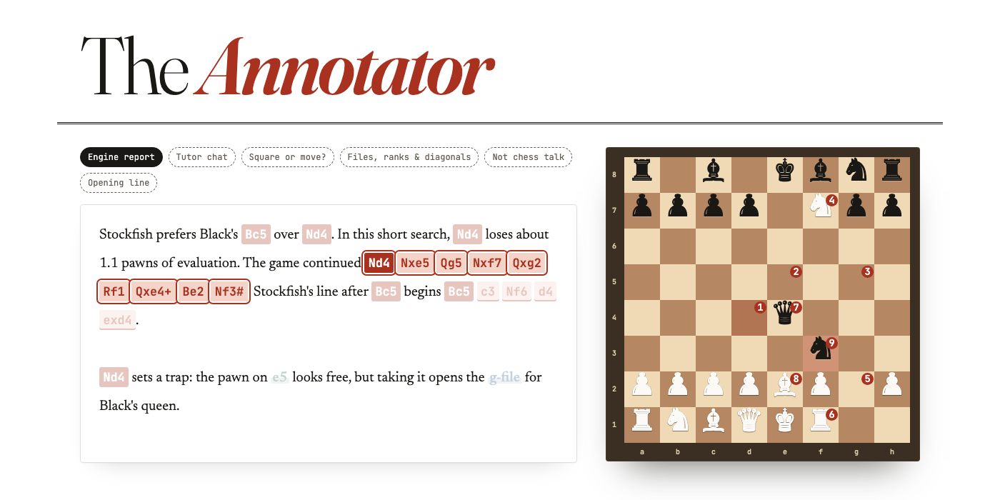

# chess-moves-from-text

A small model that reads chess commentary and finds every **move** and every **square, file, rank and diagonal** in it, with exact character positions. It's built for the chess-tutor app: the tutor's explanations ("Stockfish prefers Qxd5 over Nb8. The game continued Nb8 Nf3 c6…") become interactive, so clicking a move shows the board after it, and clicking a square or a file highlights it.

The model is [LiquidAI/LFM2.5-Encoder-230M](https://huggingface.co/LiquidAI/LFM2.5-Encoder-230M) fine-tuned for token classification. It only *detects*. Turning detections into links, highlights and move replays is the app's job.

**Live demo: [chess-annotator.vercel.app](https://chess-annotator.vercel.app)**. The model runs in your browser; nothing is sent to a server.



## What it finds

Every span gets one of six types:

| type | example | clicking it in the app… |
|---|---|---|
| `START` | "prefers **Qxd5**" | shows the board after: current position → this move |
| `CONT` | "continued Nb8 **Nf3 c6**" | shows the board after: current position → the series' START → … → this move |
| `SQUARE` | "the pawn on **d5**" | highlights the square |
| `FILE` | "the **c-file** is open" | highlights the column |
| `RANK` | "a rook on the **7th rank**" | highlights the row |
| `DIAGONAL` | "the **a1-h8** diagonal" | highlights the diagonal |

The *current position* is the one before the move being discussed. A single move is a `START` with nothing after it; a series (a "line") is a `START` followed by `CONT`s:

```
Stockfish prefers Black's [[Qxd5]] over [[Nb8]]. The game continued [[Nb8]] [[>Nf3]] [[>c6]] [[>dxc6]].
                          START         START                       START   CONT     CONT    CONT
```

Clicking `dxc6` replays Nb8 → Nf3 → c6 → dxc6 from the current position.

A series doesn't have to be written in one go. A `CONT` continues the most recent series, however much text sits in between, and a new `START` begins a new series from the current position:

```
3...[[f6]] allows 4.[[>Bc4]], bringing the bishop to [[@c4]]. The best answer would then be 4...[[>exd4]]. A better move was 3...[[exd4]], leading to 4.[[>Nxd4]].
    START           CONT                             SQUARE                                     CONT                             START                  CONT
```

Why a model and not a regex: `e4` is a move in "White played e4", a square in "the pawn on e4", and part of a series in "the game continued Nb8 Nf3 e4"; "the c-file" is a file but "the PGN file" is nothing. Only the context tells them apart.

## Results (model v2)

Scored on 294 test texts the model never trained on: 150 from sentence templates held out of training, 100 from held-out *series* templates, and 44 hand-written ones, including real chess-tutor output. A span counts only if its start, end **and** type are exactly right (`python scripts/evaluate.py`).

| | F1 v2 | F1 v1 |
|---|---|---|
| **all spans, correct type** | **0.958** | 0.881 |
| all spans, any type (detection) | 0.996 | 0.998 |
| START / CONT | 0.943 / 0.976 | 0.868 / 0.882 |
| SQUARE | 0.898 | 0.867 |
| FILE / RANK / DIAGONAL | 1.00 / 1.00 / 1.00 | 0.97 / 1.00 / 1.00 |

By test group:

| test group | examples | F1 v2 | F1 v1 |
|---|---|---|---|
| held-out templates | 150 | 0.953 | 0.945 |
| held-out *series* templates | 100 | **0.961** | 0.824 |
| hand-written | 44 | **0.961** | 0.894 |

**What changed in v2: series that continue after prose.** v1 learned that a `CONT` comes right after its series. When a tutor names a move, talks about it and only later continues the line ("Keeping the tension with Nd7 is the other option, but then **dxe5** dxe5 Bc4…"), v1 often started a new series at `dxe5` instead. v2 is trained with the same notebook on 500 extra examples of exactly this (`SERIES_TEMPLATES` in `data/generate_dataset.py`); the labels are unchanged.

The browser demo runs a 4-bit copy of the model (145 MB instead of 920 MB) that scores 0.953 instead of 0.958.

### Known limitations

It almost never misses a reference; nearly all mistakes are about the **type**. These were found with v1:

- **Unfamiliar phrasings of a series.** In "I would start with e5, and only after **dxe5** play h4", `dxe5` is read as a START instead of a CONT.
- **A square named with a verb right after a series** ("…Nxe5, the knight eyes **f7**", "hitting **d5**") is often read as the next move of that series. "The pawn on d5" works.
- A square at the start of a list ("squares like **d8** and c1") is sometimes read as a move.
- Castling written with zeros (`0-0`) and move numbers right after a result (`0-1; 9. Bxb5`) can confuse it.
- The labels can't express side branches ("instead of Ne2, Nf3 was also possible") or lines from another position (an opening from move 1). The app should replay each series with a chess library and only link it if every move is legal.
- Ranks are often counted from the speaker's side ("Black's rook on the 7th rank" is White's 2nd rank).

The fix for most of these is more varied training data: add the failing phrasings to `data/generate_dataset.py` or `data/handwritten.txt` and retrain.

## Using the model

### 1. Download it

The weights live in the [GitHub release](https://github.com/manoletre/chess-moves-from-text/releases/tag/model-v2.0.0), not in git:

```bash
gh release download model-v2.0.0 --pattern 'chess-move-tagger-v2.zip'
unzip chess-move-tagger-v2.zip        # creates ./chess-move-tagger/ (~920 MB, for Python)
```

The release also has `chess-move-tagger-v2-web.zip`, the 4-bit browser model. Unzip it into `web/` to get `web/model/` without exporting it yourself.

### 2. Run the demo page

The page in `web/` is static: the model runs in the browser with [ONNX Runtime Web](https://onnxruntime.ai/docs/tutorials/web/). It needs the browser model in `web/model/`, either from the release (above) or exported from `chess-move-tagger/`:

```bash
pip install -r requirements-model.txt
python scripts/export_onnx.py          # chess-move-tagger/ -> web/model/ (4-bit, in 50 MB parts)
python -m http.server 8000 --directory web
open http://localhost:8000
```

Pick an example or type your own text. Hover the highlights: locations light up on the board, and hovering a move replays its series from the example's position with [chess.js](https://github.com/jhlywa/chess.js). Moves that can't be played from that position are crossed out. That's either a model mistake or text about another position, and it's the same check chess-tutor should do before linking a series. Typed text starts from the initial position.

The first visit downloads 145 MB; after that the browser keeps the model in its cache. Tagging a text takes about 0.2 s.

To deploy it (Vercel's free plan rejects files over 100 MB, hence the parts):

```bash
cd web && npx vercel deploy --prod
```

### 3. Or call it from Python

```python
from chess_tagger import ChessTagger

tagger = ChessTagger("chess-move-tagger")
tagger.tag("The game continued Nb8 Nf3, and the pawn on d5 falls.")
# {"spans": [{"start": 19, "end": 22, "type": "START", "text": "Nb8", "series": 0, "index": 0},
#            {"start": 23, "end": 26, "type": "CONT",  "text": "Nf3", "series": 0, "index": 1},
#            {"start": 44, "end": 46, "type": "SQUARE", "text": "d5"}],
#  "series": [[...Nb8, ...Nf3]], "highlights": [...d5], "truncated": false}
```

Texts longer than 512 tokens are cut off (`"truncated": true`). `pip install -r requirements-model.txt` first. In JavaScript, `web/tagger.js` returns the same shape.

## How it works

1. **Tokenize.** `Qxd5` becomes ` Q`, `x`, `d`, `5`.
2. **Encode.** The LFM2.5 encoder reads all tokens at once, in both directions, and turns each one into 1024 numbers describing it in context.
3. **Classify.** A linear head (1024 × 13) scores 13 labels per token in the BIO scheme: `O` (nothing) or `B-`/`I-` (first/other token of a span) + one of the six types.
4. **Decode.** Consecutive tokens are merged back into character spans, and stray punctuation (`,` `!?` `**`) is trimmed, keeping `+` `#` `=`.

## Training your own version

1. **Data** (optional, since the files are already committed):
   ```bash
   pip install -r requirements.txt
   python data/generate_dataset.py
   ```
2. **Training** happens in Google Colab on a free T4 GPU. Open `notebooks/train_chess_move_tagger.ipynb` in Colab (*File → Upload notebook*), choose *Runtime → Change runtime type → T4 GPU*, and run all cells. When asked, upload `data/train.jsonl`, `data/val.jsonl` and `data/test.jsonl`.
3. The notebook saves the fine-tuned model to Google Drive (`MyDrive/chess-move-tagger`).

The notebook is written for a first-time encoder trainer. Every step (tokens, BIO labels, the classification head, the loss, the training loop, evaluation) is explained right above the code that does it.

## Layout

```
web/                    # the demo page (static; deployed to Vercel)
  tagger.js             # tokenizer + ONNX Runtime Web inference + decoding (mirrors chess_tagger/model.py)
  app.js                # editable text, highlights, board
  model/                # browser model, not in git (scripts/export_onnx.py or the release)
chess_tagger/
  model.py              # load the trained model and tag text (mirrors the notebook)
scripts/
  evaluate.py           # span-level precision / recall / F1 on a dataset split
  export_onnx.py        # trained model -> 4-bit ONNX for the browser (web/model/)
data/
  generate_dataset.py   # synthetic data: real legal moves (python-chess) + chess-tutor-style templates
  handwritten.txt       # hand-labelled examples, test set only; add real chess-tutor output here
  train.jsonl           # 1500 examples: 1000 v1 + 500 series-after-prose (v2)
  val.jsonl             #  225 examples, same templates as train (used to pick the best epoch)
  test.jsonl            #  294 examples: held-out templates + held-out series templates + handwritten.txt
notebooks/
  train_chess_move_tagger.ipynb
```

## Data format

One JSON object per line. `spans` are character positions: `text[19:22] == "Nb8"`. `marked` is the same thing in human-readable form, with a prefix per type:

| markup | type | mnemonic |
|---|---|---|
| `[[Qxd5]]` | START | |
| `[[>Ne2]]` | CONT | `>` continues |
| `[[@e4]]` | SQUARE | `@` at |
| `[[\|c-file]]` | FILE | `\|` vertical line |
| `[[_7th rank]]` | RANK | `_` horizontal line |
| `[[/a1-h8]]` | DIAGONAL | `/` diagonal line |

```json
{"text": "The game continued Nb8 Nf3 c6, and the pawn on d5 falls.",
 "spans": [[19, 22, "START"], [23, 26, "CONT"], [27, 29, "CONT"], [47, 49, "SQUARE"]],
 "marked": "The game continued [[Nb8]] [[>Nf3]] [[>c6]], and the pawn on [[@d5]] falls.",
 "source": "handwritten"}
```

To add your own examples, write them in this markup in `data/handwritten.txt`, one per line (`\n` for line breaks).

## Design notes

- **Only resolvable locations are labelled.** Each span is the smallest text that identifies the location: `c-file`, `7th rank`, `a1-h8`. Vague references like "the long diagonal" or "the back rank" stay unlabelled. Evaluations (`+1.3`), results (`1-0`) and look-alikes (`A4`, `B12`) are mixed into the training data unlabelled, on purpose.
- **Annotations are not part of the move.** For `Nf3!?` or `**Qxd5**`, the span is `Nf3` / `Qxd5`. Check (`+`), mate (`#`) and promotion (`=Q`) *are* part of the move.
- **Loading the encoder.** `AutoModel.from_pretrained("LiquidAI/LFM2.5-Encoder-230M")`, as the model card suggests, silently loads *random* weights with current `transformers`: the checkpoint's parameter names carry an `lfm2.` prefix that the bare body doesn't expect. The notebook loads `AutoModelForMaskedLM` instead and uses its `.lfm2` body. For inference, `chess_tagger` builds the architecture from the config alone and copies the fine-tuned weights in one tensor at a time, so memory peaks at ~1× the model size.

## License

The fine-tuned weights are a derivative of LFM2.5-Encoder-230M and fall under the [LFM Open License v1.0](https://huggingface.co/LiquidAI/LFM2.5-Encoder-230M/blob/main/LICENSE).
